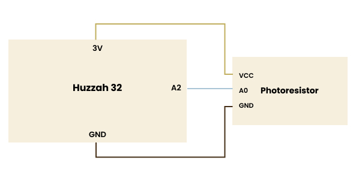
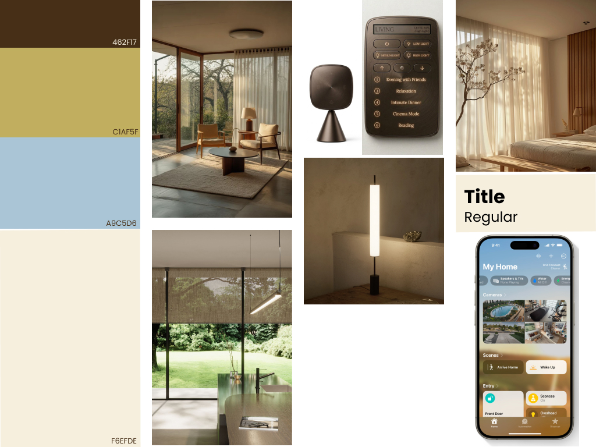
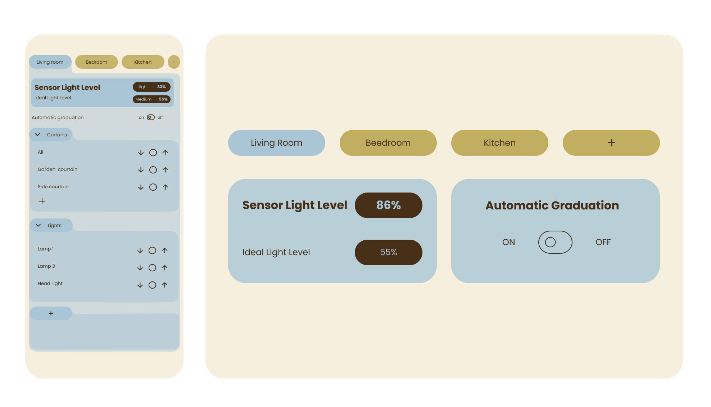
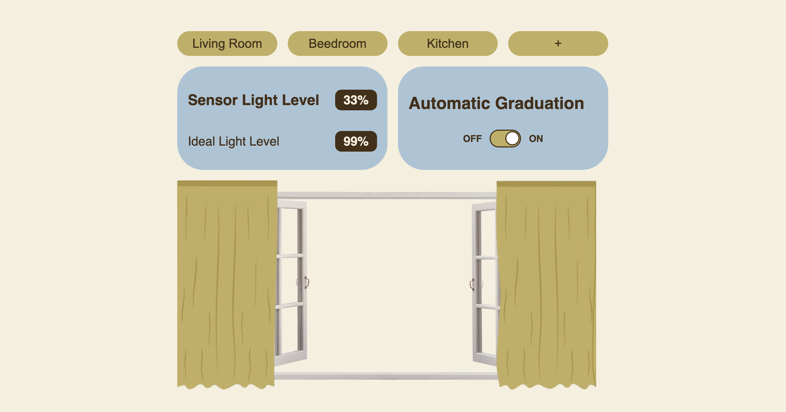
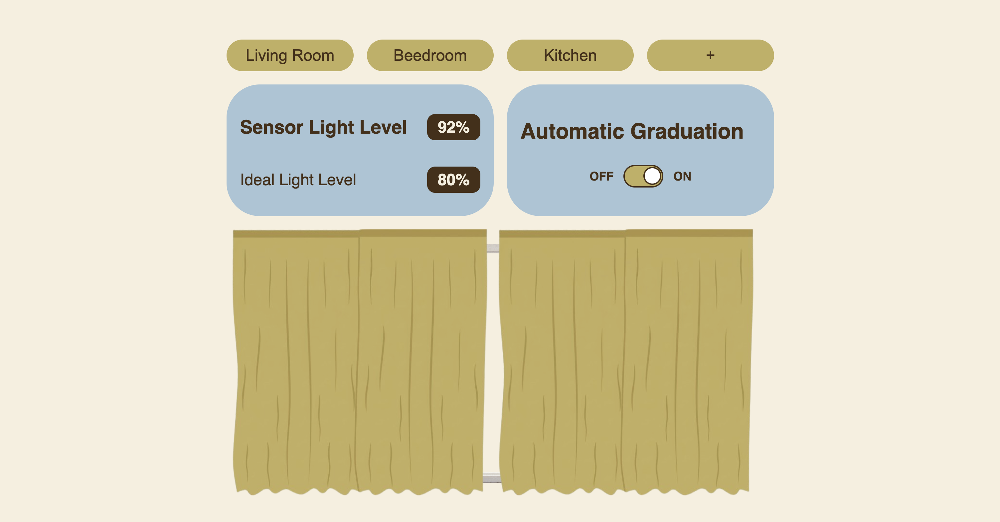

# Valeria curtains project

Voici la table des matières de mon rendu
- [Code of the electronic part↗️](cwiot/project.ino)
- [schematic view](#schematic-view)
- [Moodboard](#moodboard)
- [UI on figma](#figma-ui)
- [Code of the web part↗️](dww/index.html)
- [Video](#video)

## schematic view
<picture>
    
</picture>

This prototype consists of a photoresistor and a HUZZAH32 microcontroller.

## Moodboard

<picture>
  
</picture>

## Figma UI

[figma UI↗️](https://www.figma.com/design/qOd9WjoOD0QG80i1MIIcFg/Valeria_dww_?node-id=13-17&t=1EdV91ra2XWlSwZp-1)

## Web part
Here is a preview of the assignment.

## Video

[See the video on youtube↗️](https://youtu.be/OT8EXX_bKJA)